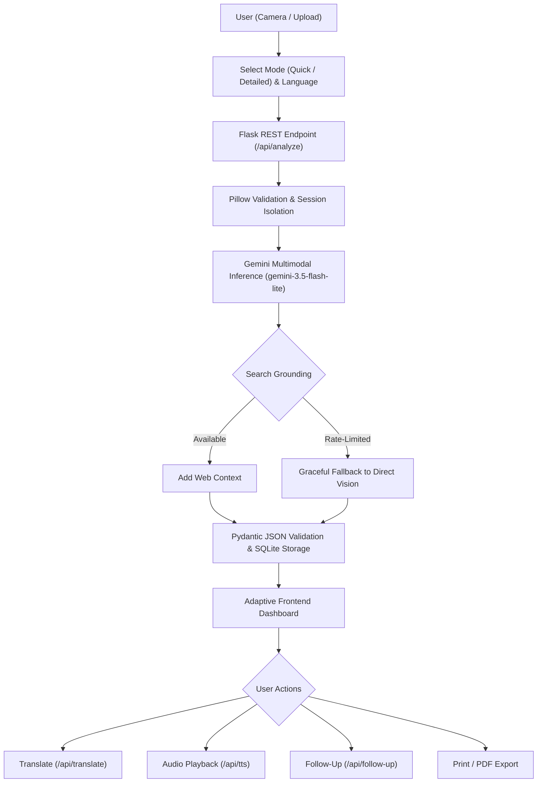

# LifeLens AI – Everyday Visual Assistant

> **Capture. Understand. Solve.**

LifeLens AI is an intelligent visual assistant powered by Generative AI and Multimodal LLMs. It converts everyday camera captures and uploaded images into structured diagnosis, practical troubleshooting steps, and actionable advice across home appliances, utility bills, packaging, alerts, and general objects.

---

## Key Capabilities

- **Multimodal Visual Intelligence**: Uses Google Gemini models (`gemini-3.5-flash-lite`) to interpret problems, diagrams, notices, and everyday scenes.
- **Adaptive Analytical Depth**:
  - *Quick Summary*: Rapid triage in under 3 sentences for fast everyday decisions.
  - *Detailed Guide*: Multi-paragraph technical breakdown with itemized tables, specification grids, and action checklists.
- **Multi-Image Comparison**: Compare up to 4 images side-by-side to evaluate differences, model variants, or before-and-after conditions.
- **5-Language Multilingual Suite**: Complete visual explanation and localized responses across English, Kannada, Telugu, Hindi, and Tamil.
- **Neural Text-to-Speech (TTS)**: Built-in audio playback using Microsoft Edge Neural voices with automatic gTTS fallback.
- **Conversational Follow-Up**: Ask follow-up questions about an analyzed image with contextual memory maintained across turns.
- **Clean PDF Export**: Dedicated `@media print` stylesheets generate structured PDF reports with native typography for all supported scripts.
- **Mobile-First Progressive Web App (PWA)**: Designed for smartphones with responsive touch targets, camera capture, and offline app shell caching.
- **Zero API Key Leakage**: API credentials remain strictly confined to the backend server environment.

---

## Architecture and Workflow



---

## User Interface

- **Main Dashboard**: `docs/screenshots/main_interface.png`
- **Mobile Experience**: `docs/screenshots/mobile_interface.png`
- **Detailed Mode**: `docs/screenshots/detailed_analysis.png`
- **Quick Mode**: `docs/screenshots/quick_analysis.png`
- **Multilingual Mode**: `docs/screenshots/multilingual_interface.png`

---

## Tech Stack

- **Backend**: Python 3.13, Flask 3.1
- **AI Integration**: `google-genai` SDK (`gemini-3.5-flash-lite`)
- **Image Processing**: Pillow (`PIL`)
- **Speech Synthesis**: `edge-tts` (Microsoft Neural Voices) and `gTTS`
- **Database**: SQLite3 with session-partitioned records
- **Frontend**: Single-file HTML5, CSS custom properties, vanilla JavaScript

---

## Project Structure

```
LifeLens-AI/
├── .env.example              # Safe environment variable configuration template
├── .gitignore                 # Repository exclusion rules
├── app.py                     # Flask application entry point and REST API routes
├── database.py                # SQLite database operations and session tracking
├── gemini_service.py          # Gemini multimodal prompts, schemas, and retries
├── network_utils.py           # LAN IP discovery helper for local smartphone access
├── requirements.txt           # Python application dependencies
├── security.py                # Session handling, rate limiting, and sanitization
├── test_e2e_suite.py          # Regression testing suite
├── tts_service.py             # Neural TTS audio generation service
├── docs/
│   ├── EVALUATION.md          # Sanitized performance and evaluation report
│   └── screenshots/           # Application interface screenshots
├── static/
│   ├── manifest.json          # PWA Web App Manifest
│   ├── service-worker.js      # PWA Service Worker for offline shell caching
│   └── icons/                 # Application icons
└── templates/
    └── index.html             # Finalized single-file responsive frontend
```

---

## Quickstart Guide

### 1. Prerequisites
- Python 3.10 to 3.13 installed
- A free Gemini API key from [Google AI Studio](https://aistudio.google.com/)

### 2. Setup Virtual Environment
```bash
python -m venv .venv
# Windows
.venv\Scripts\activate
# Linux/macOS
source .venv/bin/activate
```

### 3. Install Dependencies
```bash
pip install -r requirements.txt
```

### 4. Configure Environment
Copy `.env.example` to `.env`:
```bash
copy .env.example .env
```
Edit `.env` and set your key:
```env
GEMINI_API_KEY=your_actual_gemini_api_key
GEMINI_MODEL=gemini-3.5-flash-lite
FLASK_PORT=5000
FLASK_HOST=0.0.0.0
```

### 5. Run the Server
```bash
python app.py
```
Open `http://localhost:5000` in your web browser.

---

## Testing

Run the automated regression test suite:
```bash
python test_e2e_suite.py
```

---

## Evaluation Overview

A full evaluation covering 155 test cases across 8 distinct categories was executed. For the complete methodology, timing measurements, and findings, refer to [docs/EVALUATION.md](docs/EVALUATION.md).

---

## Security and Privacy

- **No Key Exposure**: API credentials are exclusively loaded from server environment variables.
- **Session Privacy**: History, favorites, and follow-ups are strictly isolated per client session.
- **Repository Hygiene**: Personal test images, local SQLite databases, private credentials, and evaluation evidence are excluded via `.gitignore`.
